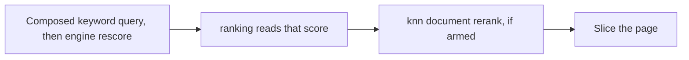

# Search V3 Design

Search V2 and Search V2.5 stay as they are until they are deprecated.

Search V3 templates change ranking once `SEARCH_V3_TEMPLATES_ENABLED` and Search V3 keyword read are on. Until then, `search_config.yaml` and the Java query builder still apply. Turning the flag on needs a GMS restart. Editing a template body does not. The enable and disable switches are listed in [Environment Variables](../deploy/environment-vars.md#search-v3-feature-switches).

Search V3 is a template-based query builder on shared, unified fields. The builder renders a `searchTemplate`, addressed by URN, into the query. An operator changes relevance by writing that URN. A caller changes one request by selecting one.

- [Overview](#overview) is the model.
- [Customization](#customization) is the template an operator writes and a caller selects.
- [Query execution](#query-execution) is how a selected template is run, ranked, and rejected.
- [Documents](#documents) is what gets indexed, and what a hit can carry.

## Overview

### Shared fields

A query, a filter, a facet, or a template names a shared field. The set is unified: that name means the same thing on every entity.

The traditional PDL model stays. An `@Searchable` annotation maps a PDL field onto a shared field. The shared name, degree, Search V3 weight, and Search V3 query-by-default flag are set on the `v3` object: `v3.searchLabel`, `v3.degree`, `v3.boostScore`, and `v3.queryByDefault`. Unset degree is 0. The top-level `queryByDefault` and `boostScore` stay the Search V2 values. Search V2 ignores `v3`. See [Degrees of separation](#degrees-of-separation). `name` collects title and name. `description` collects every description: info aspects, properties, ingested, edited, and generated. Platform is its own field, separate from the name, because a URN mixes the two. The builder queries the shared field. It does not query the PDL path.

The per-field V2 query surface is not this contract. A new entity maps its PDL fields onto the unified set with the same annotation. It does not add a builder of its own. Each aspect also keeps its own fields under `_aspects.<aspect>`, unanalyzed. The unified fields sit at the document root. A few root names stay reserved for embeddings and other data that is not an aspect. The mapping is in [Documents](#documents).

### Degrees of separation

Some facts live on the entity and again on things related to it. A dataset has tags, and its columns have tags. The dataset's own tags say more about it than the tags on its columns, and a value further away can say less again. Glossary terms, owners, and any other shared field follow the same pattern. Tags are the example.

Each distance is a field a template, a filter, or a `/q` query can name on its own. The value on the entity is degree 0, `tags`. One step away is `tags_1`. Two steps away is `tags_2`. The number is the distance, and the same number means the same distance on every entity. Column name, description, tags, and glossary terms are degree 1: `name_1`, `description_1`, `tags_1`, and `glossaryTerms_1`. Those column fields stay out of an unqualified query. A schema field leaves `v3.queryByDefault` unset. An edited column sets it false, because that field annotation also opts a business attribute in. A filter or `fields.add` names that degree. Search V2 still reads the same values through the top-level `queryByDefault`. An entity with nothing at that distance has no such field.

The model sets the distance and its default weight. A nearer distance weighs at least as much as a farther one. The default query includes a distance when `v3.queryByDefault` is true, at `v3.boostScore`. Column degrees are left out. A template then decides what a request actually runs:

- `fields.override` changes the weight of one distance that is already queried. A farther distance may weigh more than a nearer one.
- `fields.remove` drops one distance and leaves the others in the query. Removing `tags_1` keeps column tags from matching when a template added them. Removing `tags` keeps the dataset's own tags out and still searches the other distances.
- `fields.add` queries a distance the default left out, including a column degree.

The example is in [Field weights](#field-weights).

A filter, a facet, a clause, a list boost, or a highlight names one indexed field. A filter on `tags` matches the dataset's own tags. A filter on `tags_1` matches tags on its columns. A contains or existence filter on the source field matches every degree of that source. Matching more than one distance by name combines those fields. How the fields are stored is in [Documents](#documents).

### The query is a template

A template is the `searchTemplateProperties` aspect, `urn:li:searchTemplate:<id>`. It holds the query body and the sections around it: clauses, scoring, field weights, a ladder, retrieval, sort, and an ordered route list. A surface and an engine resolve to a seed URN. That seed's routes choose the template from the query text. A deployment customizes by writing a child that replaces the sections it sets, or by pointing a slot at a different URN.

A child inherits a parent. A section left unset stays. An explicit empty section drops the inherited one, so a boost, an exclusion, a rescore, a ranking preset, or the document rerank weights is a small write against a bootstrapped default. The next search renders the new body. There is no redeploy. The sections are in [Customization](#customization).

### Query time

A caller overrides the stored template for one request and does not write it. `SearchFlags.searchTemplate` selects a URN. On a search, the walk follows that template's `next`. Scroll does not. `sortCriteria` replaces the sort. On a from/size search it also replaces engine `rescore`, `ranking`, and `knn`. Aggregation flags adjust that request. Highlighting stays off. The flags are in [Runtime and query-time customization](#runtime-and-query-time-customization).

### What the service owns

On a keyword rung, soft delete, hidden lifecycle stages, requested entity types, latest-version filtering, and view authorization wrap the rendered query. A template cannot widen what the caller is allowed to see. On a vector rung, soft delete and hidden lifecycle stages are inside the kNN request, and view authorization is applied after the top-k. See [Vector retrieval](#vector-retrieval). Paging and the result cache stay in the service. System templates are editable only by the system actor.

The service does not classify the query in code. The surface, the engine, and the fulltext flag select a seed template. The seed's ordered routes then match the trimmed query, and the first match wins. A query that matches none stays on the seed unless the seed sets a default target. An empty query or `*`, with no caller URN, selects list and runs on the API the caller used. It does not force scroll. A caller-supplied URN is the entry, and its merged routes still run. Fully qualified name and deep path are shape flags. A quoted query is exact and requires the phrase. A single term with no spaces is not exact. Column search matches the column name. A structured `/q` query uses the shared field names, which the caller reads from the schema. The route tables are in [Selection](#selection).

The template body chooses a placeholder. The service computes the variations. The template does not supply a rewrite. See [Query variations](#query-variations).

A ladder tries one template, then another. The rules for entering a rung, keeping its result, and which URN to try next are data on the template. A template with no `next` does not hand off. Scroll does not walk a ladder. See [Query ladder](#query-ladder) and [Search and scroll](#search-and-scroll).

A rung renders the template sections. The ladder owns selection, stopping, joins, and `next`.

`@Searchable` maps a PDL field onto a shared field. `v3.searchLabel` and `v3.degree` name the indexed field. `v3.queryByDefault` true puts that field in the default queried set, and an unset flag leaves it out. `v3.boostScore` is its default weight. The top-level `queryByDefault` and `boostScore` stay the Search V2 values. `fields.add`, `fields.remove`, `fields.replace`, and `fields.override` choose which fields are queried and the weight of each. The author writes the `term`, `prefix`, `wildcard`, or `match` clause in the Mustache body, and the boost and `dis_max` around it. The composed keyword query adds the generated whole-value terms and the name-and-value group around that body. See [Field weights](#field-weights).

A template declares the section names this release accepts. An unknown name is rejected when the template is written and when it is loaded. `apiVersion` is 1. A ranking preset other than `none`, a window sizer other than `fixed`, vector retrieval, a bridge, and a merge join fail when that template is selected. See [Capabilities](#capabilities).

### How a request runs

Bind resolves the seed or the caller URN, follows its routes, merges parents, and checks the contract. On a search, the ladder tries rungs until one stops. The executor renders, scores, and slices a keyword rung. Scroll runs the composed keyword query and does not walk the ladder. Scroll also drops engine `rescore`, `ranking`, and `knn`, and sorts by score, then URN. Which features each API runs is in [Search and scroll](#search-and-scroll). `includeExplain` returns the explanation of the query that was served. `searchType` opts a request into DFS query-then-fetch when consistent IDF across shards matters. The steps are in [Query execution](#query-execution).

The composed keyword query is the rendered body, then whole-value terms and the name-and-value group, then `clauses`, then `functionScore`. A property in the queried set joins the weighted field list and gets a whole-value term at its field weight. It joins a `dis_max` when the author fills `extraDisMaxQueries`, or when a replaced `query` writes its path into a clause. See [Query holes](#query-holes). Inside a clause that scores by field weight, equal weights tie and a higher weight ranks above `name`. A numeric boost written in the body stays that boost. A quoted query requires the phrase. `functionScore`, engine `rescore`, `ranking`, and `knn` can still reorder inside their windows. Scroll runs this composed keyword query and still drops those three. See [Ranking](#ranking) and [Search and scroll](#search-and-scroll).

A vector participates in one of three ways, and each is a different template shape. `knn` on a keyword template reorders rows already in the keyword window and adds no hits. Corpus kNN is its own rung. A keyword rung and a vector rung can run together and add hits that only the vector leg found. In OSS the three shapes run for the Document entity only. Hybrid adds vector-only hits once a fusion policy is chosen. See [Document rerank](#document-rerank) and [Vector retrieval](#vector-retrieval).

The search box is a search. Which field matched is read from the returned page, for the fields the request opted into. The default set is empty, so the default query stays one body and fetches no highlight source. The engine highlighter stays off. A non-empty set opts into final-page source matching, and `skipHighlighting` clears that set. See [Highlight fields](#highlight-fields).

Hydration from `_source` is not implemented. Search responses still read aspects from the primary store. See [Hydrating from `_source`](#hydrating-from-_source).

## Customization

A template is the `searchTemplateProperties` aspect, addressed as `urn:li:searchTemplate:<id>`. A surface and an engine resolve to a seed URN. A deployment customizes by writing a child, or by pointing a slot at a different URN.

### Runtime and query-time customization

**Runtime** changes what every caller sees. Creating a template, editing a section, or pointing a child at a new parent is a write to `urn:li:searchTemplate:<id>` through the generic entity API, including JSON patch. After the write commits, the next search renders the new body. `application.yaml` names which seed URN a surface and an engine resolve to. The fulltext flag chooses the search seed or the structured seed. The body and the route list behind that URN change with no restart. The seeds are system templates. An operator who wants a different route list writes a child that replaces `routes` and points the slot at that child.

**Query time** changes one request and does not write the template:

- `SearchFlags.searchTemplate` selects a URN for that call.
- `sortCriteria` replaces the template sort. On a from/size search it also replaces engine `rescore`, `ranking`, and `knn`.
- `skipAggregates` and `includeDefaultFacets` adjust aggregations for the request.
- A non-empty highlight set opts into final-page source matching. `skipHighlighting` clears that set, including a template set and a caller override. A request may add, remove, or replace the template set, and `customHighlightingFields` replaces it.

The result cache key combines those service discriminators with the template discriminators, so two requests that differ in template do not share a hit and an edit does not keep serving the previous ranking.

### Template fields

These are the sections on `searchTemplateProperties`. The bodies behind the bootstrapped URNs are not specified here.

| Field                     | What it does                                                                                                                                                   | Detail                                                                           |
| ------------------------- | -------------------------------------------------------------------------------------------------------------------------------------------------------------- | -------------------------------------------------------------------------------- |
| `name`                    | Display name. Not part of the query.                                                                                                                           |                                                                                  |
| `description`             | What this template ranks or matches. Not part of the query.                                                                                                    |                                                                                  |
| `parent`                  | Template whose unset sections this one inherits.                                                                                                               | [Inheritance](#inheritance)                                                      |
| `editable`                | When false, only the system actor may change the template.                                                                                                     | [What stays fixed](#what-stays-fixed)                                            |
| `dialect`                 | Body language. The request has to match it.                                                                                                                    | [Dialect](#dialect)                                                              |
| `apiVersion`              | Template contract. This release implements 1.                                                                                                                  | [Capabilities](#capabilities)                                                    |
| `capabilities`            | Section names this body declares. An unknown name is rejected when the template is written.                                                                    | [Capabilities](#capabilities)                                                    |
| `query`                   | Mustache body for this rung. Used when retrieval is keyword. Setting it replaces the whole body.                                                               | [Query composition](#query-composition)                                          |
| `queryFragments`          | JSON spliced into a named hole the parent body has opened.                                                                                                     | [Query holes](#query-holes)                                                      |
| `clauses`                 | Extra bool clauses merged into that body.                                                                                                                      | [Query composition](#query-composition)                                          |
| `functionScore`           | Score functions wrapped around the body. A filter snippet is for a boost that is not list membership.                                                          | [Query composition](#query-composition), [List boosts](#list-boosts)             |
| `boosts`                  | List-membership weights. Each entry is a field, an injectable list, and a weight.                                                                              | [List boosts](#list-boosts)                                                      |
| `fieldValueScores`        | Numeric multipliers for an index field or a structured property. Naming a property turns scoring on. Omitted extents come from the definition's `score`.       | [Numeric property scores](#numeric-property-scores)                              |
| `entityTypeBoosts`        | Positive weights for named entity types, multiplied onto the rendered query. A weight of 1 is omitted. A request that names one entity type skips the section. |                                                                                  |
| `rescore`                 | An engine rescore window after that wrapper, on a from/size search. Scroll drops it.                                                                           | [Query composition](#query-composition), [Search and scroll](#search-and-scroll) |
| `ranking`                 | Preset that reorders the engine window after the query returns, on a from/size search. Scroll drops it.                                                        | [Ranking](#ranking), [Search and scroll](#search-and-scroll)                     |
| `routes`                  | Ordered query matchers that choose another template before this body runs. An empty list pins this template. A miss stays here unless a default target is set. | [Selection](#selection)                                                          |
| `ladder`                  | On a search: when to run this rung, when to keep the result, and the next template URN. Scroll ignores it.                                                     | [Query ladder](#query-ladder), [Search and scroll](#search-and-scroll)           |
| `retrieval`               | How this rung retrieves. Unset is keyword. `vector` retrieves by embedding.                                                                                    | [Vector retrieval](#vector-retrieval)                                            |
| `knn`                     | Weights that reorder document rows already in the keyword window, on a from/size search. Scroll drops it.                                                      | [Document rerank](#document-rerank), [Search and scroll](#search-and-scroll)     |
| `aggregations`            | Facets for this rung. Unset keeps the schema default facets.                                                                                                   | [Query sequence](#query-sequence)                                                |
| `sort`                    | Sort for this rung. Unset keeps score, then URN, unless engine `rescore`, `ranking`, or `knn` is applied.                                                      | [Query composition](#query-composition)                                          |
| `fields`                  | Queried fields and one weight each. Each degree of separation is its own field.                                                                                | [Field weights](#field-weights)                                                  |
| `structuredPropertyQuery` | Analyzed value, exact value, and name-and-value clauses. A child replaces only the clauses it sets.                                                            | [Name and value](#name-and-value)                                                |
| `highlightFields`         | Fields opted into final-page source matching. The engine highlighter stays off.                                                                                | [Highlight fields](#highlight-fields)                                            |
| `parameters`              | Named values the body can reference, such as `deprecatedBoost`.                                                                                                | [Render context](#render-context)                                                |
| `created`                 | When the template was first written. Callers omit it.                                                                                                          | [Stamps](#stamps)                                                                |
| `lastModified`            | When the template was last written. Callers omit it. Part of the result cache key.                                                                             | [Stamps](#stamps)                                                                |

### Inheritance

A child sets `parent` and replaces only the sections it includes. Leaving a section unset keeps the parent.

An explicit empty string drops that section, including an inherited `knn`, `ranking`, `retrieval`, or `ladder`. A child can keep the parent's `functionScore` and `boosts` and drop the parent's rerank, the parent's ranking, or the parent's hand-off. An explicit empty `boosts` drops an inherited list. An explicit empty `structuredPropertyQuery` drops the inherited clauses. A child replaces only the clauses it sets. See [Name and value](#name-and-value).

`fields` merges by key. A child's `add`, `remove`, and `override` combine with the parent's, and the child's `override` wins when both name the same field. When the parent set `replace`, those child keys apply to that set. A child's `replace` replaces the queried set and discards the parent's `add`, `remove`, and `override`.

`queryFragments` merges by hole name. Every level that sets a non-empty key adds a fragment, joined root-first with commas. An unset key adds nothing. An empty string drops inherited fragments for that key. See [Query holes](#query-holes).

`routes` replaces the whole list. Unset keeps the parent's list. An explicit empty list drops it, which is how a route target stays on the body it was routed to. A non-empty child list replaces the parent's order. There is no per-route merge. A default target is separate from the list. Unset keeps the parent's target. Setting one replaces it. Clearing it leaves a miss on this template.

A rung does not reuse the previous rung's `functionScore`, `boosts`, `fields`, `clauses`, or `structuredPropertyQuery`. Those travel only when the next template names this one as `parent`.

### Query holes

A child inserts query JSON into a named hole the parent has opened. Setting `query` still replaces the whole body. `queryFragments` maps a hole name to that JSON. `parameters` stays a separate map of named values.

A parent opens `extraDisMaxQueries` inside a `dis_max` `queries` array. The parent emits a comma and the fragment only when the fragment is set, so an empty hole leaves the JSON valid. The fragment does not start with a comma. Several query objects separated by commas become further branches of that `dis_max`.

```json
{{#extraDisMaxQueries}}
,{{&extraDisMaxQueries}}
{{/extraDisMaxQueries}}
```

Parent and child templates extend the same hole name; they do not create `Next` or `Next2` holes. The loader walks root-first and joins each level's fragment with a comma. A fragment may itself contain several comma-separated query objects. Setting the key to an empty string at a level clears the pieces inherited above it, while descendants may add new pieces.

Each fragment is rewritten for structured-property definition URNs, then rendered with the same Mustache context as the query, then spliced. It is not rendered again, and it does not see other fragments. `{{urn:li:structuredProperty:...}}` resolves to the current field. `{{unquoted}}` and the other query variables expand.

`parent` is searchable with `queryByDefault` false. `searchTemplate` stays out of the default search, browse, and autocomplete entity-type lists. The validator queries that field by entity type. A child write that fills a hole the inherited query does not contain is rejected. A parent `query` write loads direct children whose `parent` is this URN and walks. A child that does not set `query` inherits this body, so every hole it fills must still appear in the new text, and the walk continues to its children. A child that sets `query` stops the walk. Where a remaining hole sits is not checked. The search index can lag a write. Rendering fails when the merged template fills a hole the merged query text does not contain, so the search does not run with the extension left out.

`fields.add` still only changes the weighted field list and the whole-value term. `clauses` still merge outside that `dis_max`, so those scores add. A field does not declare `exact` or `prefix` for the builder to emit. There is no separate append combiner. Setting `query` remains the way to replace the body when the parent has not opened a hole.

### Dialect

`ELASTICSEARCH` is rendered as query DSL and parsed before the search runs. Elasticsearch and OpenSearch share that dialect. An engine that needs a different clause points its slot at a child template. `POSTGRES` stores Mustache text for a future SQL compiler. Search V3 does not execute it. A `next` URN, a route target, or an explicit `SearchFlags.searchTemplate` of a different dialect fails the search.

### Capabilities

`apiVersion` is the template contract. This release implements 1. Unset inherits the parent version, or resolves to 1 when no ancestor sets it. Any other value is rejected when the template is written and when it is loaded.

`capabilities` names the sections this body declares. Unset keeps the parent list. An empty list drops it. A non-empty list replaces it. Declaring a name does not turn a section on. Any other name is rejected when the template is written and when it is loaded.

| Name                      | What it names                                    |
| ------------------------- | ------------------------------------------------ |
| `keyword`                 | The keyword query                                |
| `rescore`                 | Engine rescore                                   |
| `functionScore`           | The function score wrapper                       |
| `routes`                  | Ordered routes                                   |
| `ladder`                  | The ladder                                       |
| `aggregations`            | Facets                                           |
| `structuredPropertyQuery` | Structured-property clauses                      |
| `normalization`           | Wildcard, synonym, fuzzy, and broad-query limits |
| `fieldOverrides`          | `fields`                                         |
| `highlights`              | `highlightFields`                                |
| `sort`                    | Sort                                             |
| `boosts`                  | List-membership weights                          |
| `fieldValueScores`        | Numeric field and property scores                |
| `entityTypeBoosts`        | Entity-type weights                              |
| `queryFragments`          | Query holes                                      |

After parent merge, a ranking preset other than `none`, a window sizer other than `fixed`, vector retrieval, a bridge, and a merge join fail the search. `knn` runs when the request includes the Document entity. The service does not drop that section and return keyword order. On scroll, `next` is unread, so a `next` this release cannot run does not fail the scroll. On a search, it does. Scroll still skips the sections that a cursor cannot continue. See [Search and scroll](#search-and-scroll) and [Document rerank](#document-rerank).

### Field weights

`fields` exists so a template can change which shared fields are searched, and how hard, without a code change. The default set is every indexed field whose `v3.queryByDefault` is true, at that field's `v3.boostScore`, plus every structured property whose `searchConfiguration.queryByDefault` is true, at that configuration's `boostScore`. When `v3.boostScore` is unset, Search V3 uses the top-level `boostScore`. When `v3.queryByDefault` is unset, the field stays out of an unqualified Search V3 query; set it true to opt in. The top-level flags stay the Search V2 values. The indexed field is the shared field at degree 0, and `<sharedField>_<degree>` above that. Column degrees stay out of that set. Those annotation values are schema defaults: `v3.boostScore` does not increase with degree on one entity and shared field. Schema validation requires one degree for an aspect location and one `v3.queryByDefault` and `v3.boostScore` for an indexed name, including across entities. See [Documents](#documents). A structured property has one definition, so its `queryByDefault` and `boostScore` are the same on every entity type that definition allows. The annotation or definition weight applies only where the template sets no weight, and the template's field set and weights are what the request runs.

`override` sets the weight of a field that is already in the queried set. One field, one weight. That weight is what the weighted field list uses, and what a structured property's generated whole-value term uses as its boost. In the list, text is queried at that weight and the stemmed subfield at half, except on the name fields, which have no stemmed subfield. A numeric boost written in the body stays the boost the author wrote. Override does not change `nameAndValue.weight`. The same documents match. `rescore` and `ranking` read the resulting score. They do not carry a field-weight list of their own. An `override` of a field that is not in the queried set is rejected at write time.

`add` puts a field into the queried set at the weight written on the entry, so a document that matches only that field can appear. `remove` drops a field, so a document that matched only that field can disappear. `replace` replaces the whole list and each weight. `replace` cannot be combined with `add`, `remove`, or `override`.

A child that only overrides a weight inherits the parent's query, clauses, ladder, rescore, ranking, and the rest of `fields`. A saved ranking is that child. The section it sets is `fields.override`. It may also set `ranking` when the preset itself should change. It does not set `query` or `fields.remove`. There is no second ranking entity.

```yaml
parent: urn:li:searchTemplate:fulltext
fields:
  override:
    - fieldName: name
      boost: 10
```

`name` remains queried. A hit that matched on `description` still matches. Order can change because `name` is `^10` in the weighted field list. A numeric boost written in the body stays the boost the author wrote.

Each degree is its own indexed field. Each is in the default queried set when its own annotation sets `v3.queryByDefault`, and each takes that annotation's `v3.boostScore`. Column tags are `tags_1` and are left out of an unqualified query, so the example adds them. An override applies only to a degree already in the queried set, and an override of a degree outside the set is rejected. The non-increasing rule binds annotation defaults, not templates. A degree that no annotation indexes cannot be named.

The merge key is the indexed name. An override of `tags` leaves `tags_1` alone. Removing `tags_1` keeps a column tag from matching. Removing `tags` keeps the dataset's own tags out of the query and still searches the other degrees.

```yaml
parent: urn:li:searchTemplate:fulltext
fields:
  override:
    - fieldName: tags
      boost: 8
  add:
    - fieldName: tags_1
      boost: 2
    - fieldName: tags_2
      boost: 3
```

The same shape covers glossary terms and owners. A clause, a list boost, a facet, or a highlight names the indexed field. A filter that matches more than one degree is a disjunction of those fields. Sort names score, then URN, or a numeric usage field.

`fields.add`, `fields.remove`, `fields.replace`, and `fields.override` choose which fields are queried and the weight of each. The rendered `query` section is the body. The author writes the `term`, `prefix`, `wildcard`, or `match` clause, and the boost and `dis_max` around it. The builder substitutes resolved field paths into that body and fills `{{&defaultQueryFieldsJson}}` from the queried set. It does not emit a clause because a mode was set.

The composed keyword query is that rendered body, then one generated whole-value term per included structured property, then the name-and-value group when `nameAndValue.weight` is set, then `clauses` and `functionScore`. Search may still attach `rescore`, `ranking`, and `knn`. Scroll runs the composed keyword query and drops those three.

A structured property is named by its definition URN and changed with the same `add`, `remove`, and `override` operations. Those operations, and `replace`, decide which properties are queried and which join name-and-value expansion. `nameAndValue.weight` is not an override. Every included property gets a whole-value term at its field weight, including when the body also names that property. `fields.override` changes that term's boost and the property's `path^weight` in the weighted field list. It does not rewrite a numeric boost written in the body, and it does not change `nameAndValue.weight`. Removing the field drops it from the list, drops its whole-value term, and drops its name-and-value clause. After render, a clause that targets only the removed field is removed. A multi-field clause loses that field and is removed when no field remains. See [Structured properties](#structured-properties).

Inside the weighted field list, equal weights tie and a higher weight ranks above `name`. A numeric boost written in the body stays the boost the author wrote. A property joins a `dis_max` when the author fills `extraDisMaxQueries`, or when a replaced `query` writes its path there. See [Query holes](#query-holes) and [Ranking](#ranking).

```yaml
parent: urn:li:searchTemplate:fulltext
fields:
  add:
    - fieldName: urn:li:structuredProperty:businessName
      boost: 10
```

This `add` puts Business Name in the queried set. It gets a whole-value term at boost 10, and its analyzed path joins the weighted field list at `^10`. A name-only clause the author wrote stays name-only. See [Structured property references](#structured-property-references).

### List boosts

List membership is one structured boost, the same closed shape as Azure's tag function and Algolia's optional filters. The list is a parameter. The boost is not a free snippet.

Each entry names a field, an injectable, and a weight. The injectable is `viewerUrn`, `viewerGroupsJson`, `viewerDomainsJson`, or `domainsJson`. What each value contains is in [Render context](#render-context). `viewerUrn` is that entry with one value.

The service renders a `terms` filter on the field and applies the weight. `score_mode` and `boost_mode` stay on `functionScore`. An empty list adds no function, so a platform-wide policy leaves the `domainsJson` boost unfired. A child that sets `boosts` replaces the parent's list. Leaving `boosts` unset keeps it.

```yaml
boosts:
  - field: domains
    values: domainsJson
    weight: 1.5
```

`functionScore` stays the wrapper for a boost that is not list membership. It holds `functions`, `score_mode`, and `boost_mode`. Shipped keyword templates set `score_mode` to `multiply`, so each matching weight scales the text score and a document that misses a filter is unchanged. Each function is a score function the engine accepts, such as `weight`, `field_value_factor`, or a decay function. A filter on that function is a snippet the author writes for a term on one literal, a numeric field, or a decay. The snippet and the function's other fields reference parameters, the same way a weight references `{{deprecatedBoost}}`. The service supplies those values and leaves that function list as the author wrote it. A snippet that references `viewerUrn`, `viewerGroupsJson`, `viewerDomainsJson`, or `domainsJson` is rejected at write time. A clause may still reference those values to narrow.

### Highlight fields

Which field matched is read from values already on the returned page, for the fields this request opted into and this query searches. The check runs after ranking and page selection, so a discarded window row is not scanned, and it stops at the first matching value in each field. An empty set fetches nothing. The default query stays one body.

A named query identifies a field only when that field is its own clause. A `multi_match` does not say which inner field matched. Lucene already scores a sub-query per field inside that one body, so a `_name` on every field costs template size rather than query time. The template does not grow one per queried field, including every degree of separation and every structured property the query searched. An author may still name a distinct clause. That name is what a structured-property match reports. It does not replace the field check.

A structured-property match reports the definition URN and the matched value. It also reports `exact`, `prefix`, `contains`, or `nameAndValue` when the matching clause has that `_name` and names one structured-property field. The author writes `exact`, `prefix`, or `contains` on the clause. The executor writes `nameAndValue` on the expanded name-and-value clause. A missing name, a reused name, or a clause that names several properties leaves the mode unset. The report does not invent one. Shared-field matches stay indexed names. Write time does not require these names. The report is what a result card uses to show the value that matched. Result-card layout stays outside this contract. It is a companion dependency of this Search V3 result.

The comparison uses values on the returned document. A shared field filled only by `copy_to` is not stored, which keeps that cost off every write, so the check reads the source fields copied into it. A keyword is the value itself, folded the same way as the folded copy when the match was case-insensitive. Analyzed text uses the same approximate mark the UI applies. That mark can miss a hit found only through a stem, a fuzzy edit, a synonym, or a phrase with slop. The drift is accepted. The engine highlighter stays off on a template request.

Shipped templates leave `highlightFields` unset, so the default set is empty. A template opts fields in only when that cost is warranted. A child changes the set with `add`, `remove`, and `replace`. `replace` cannot be combined with `add` or `remove`. An explicit empty section clears the set. A request applies the same section after the template set. `customHighlightingFields` replaces that set outright, including a V2 subfield normalized to its indexed root, and the request section is not applied on top of it. `skipHighlighting` then clears whatever remains. The section has no weight. It names an indexed field, including a degree field such as `tags_1` and a structured property such as `structuredProperties.tier`, which is read where it is stored because `copy_to` does not put its value on the shared field. A field this query does not read, an aspect path, a wildcard, or a subfield the index does not store is dropped. The engine highlighter stays off. A non-empty set fetches those source paths, including the fields copied into a selected shared field, and matches them on the final page.

### Examples

A child of `fulltext` that buries deprecated assets. Column name, description, tags, and glossary terms are already left out of an unqualified query.

```yaml
parent: urn:li:searchTemplate:fulltext
clauses: |
  { "must_not": [ { "term": { "deprecated": true } } ] }
functionScore: |
  {
    "functions": [
      { "filter": { "term": { "deprecated": { "value": true } } }, "weight": 0.5 }
    ],
    "score_mode": "multiply",
    "boost_mode": "multiply"
  }
```

Leaving `knn` or `ranking` unset keeps the parent's section. Setting `knn` to empty drops an inherited rerank and leaves the ranking-step order. Setting `ranking` to empty drops an inherited preset and leaves the query order. Setting only `query` leaves an inherited `ladder` in place, so the child still hands off through `next`.

A child that queries a structured property the definition left out names the definition URN and a weight. See [Structured properties](#structured-properties). This `add` puts Business Name in the queried set. It gets a whole-value term at boost 10, and its analyzed path joins the weighted field list at `^10`. A name-only clause the author wrote stays name-only. A second child suppresses a property the definition included and overrides the weight of one already in the set. That override changes the steward whole-value term and its entry in the weighted field list. It does not change `nameAndValue.weight` or a numeric boost written in the body. `name` stays at its `v3.boostScore` because neither child sets `replace`. The parent's `fields` keys merge with these. See [Inheritance](#inheritance).

```yaml
parent: urn:li:searchTemplate:fulltext
fields:
  add:
    - fieldName: urn:li:structuredProperty:businessName
      boost: 10
```

```yaml
parent: urn:li:searchTemplate:fulltext
fields:
  remove:
    - fieldName: urn:li:structuredProperty:certification.status
  override:
    - fieldName: urn:li:structuredProperty:steward
      boost: 4
```

To rank Business Name in the same `constant_score` as `name`, fill the fulltext hole. The fragment is one more branch of that `dis_max`. The boost is the boost written in the fragment. `fields.add` does not change it. Setting `query` still replaces the whole body when the clause has no hole to fill. See [Query holes](#query-holes).

```yaml
parent: urn:li:searchTemplate:fulltext
queryFragments:
  extraDisMaxQueries: |
    {
      "constant_score": {
        "_name": "exact",
        "boost": 1000,
        "filter": {
          "term": {
            "{{urn:li:structuredProperty:businessName}}.keyword": {
              "value": "{{unquoted}}",
              "case_insensitive": true
            }
          }
        }
      }
    }
```

Shipped fulltext enables analyzed value and exact value matching. Name-and-value runs when its weight is set, which is what makes `certification status gold` match the value `gold`. The expansion rules are in [Name and value](#name-and-value). For a string property whose display name is Certification Status, whose qualified name is `certification.status`, and whose assigned value is `gold`:

```yaml
parent: urn:li:searchTemplate:fulltext
structuredPropertyQuery:
  nameAndValue:
    weight: 8
```

| Query                         | What matches                                                                                            |
| ----------------------------- | ------------------------------------------------------------------------------------------------------- |
| `gold`                        | The value clause. The whole query is the term `gold`.                                                   |
| `certification status gold`   | The name-and-value clause for that definition. The remainder `gold` is the assigned value.              |
| `certification status silver` | Neither clause for that value. The remainder is not `gold`, and the whole query is not the term `gold`. |
| `certification status`        | No name-and-value clause. The remainder is empty, so possessing the property is not a hit.              |

A child that prefers the caller's domains names the field, the injectable list, and the weight. Leaving `functionScore` unset keeps the parent's deprecation weight.

```yaml
parent: urn:li:searchTemplate:fulltext
boosts:
  - field: domains
    values: domainsJson
    weight: 1.5
```

Point a slot at the child and every search of that intent renders it. Pass the URN on one request with `SearchFlags.searchTemplate` and only that request does.

The same child shape covers the other common changes:

- a `functionScore` boost for a tag, glossary term, platform, or `_entityType`
- a list-membership boost
- a `must_not` to exclude
- a fragment in a hole the parent opened
- a replaced `query`
- a `rescore` window
- a `ranking` preset
- a single field weight

### What stays fixed

The rendered query is combined with the caller's filter, soft delete, hidden lifecycle stages, the requested entity types, latest-version filtering, and view authorization. On a vector rung, soft delete and hidden lifecycle stages move inside the kNN request, and view authorization is applied after the top-k.

Paging and the result cache stay in the service. System templates are not editable except by the system actor.

`fields.override` leaves the hit set unchanged. `fields.add`, `fields.remove`, and `fields.replace` change which documents match. Owners group cross-match, filter order, result-card layout, Column Views, and favorites are product surfaces outside the query contract. The matched-field report names the structured property and the value that matched so a card can show Business Name. The card layout itself stays outside Search V3.

The template cannot express the following. A section that tries is rejected, or, when the process does not implement the named preset, fails the capability check:

- Painless and `script_score` in any section. Numeric boosts are `field_value_factor` or a filter weight. Formulas that read several signals are a `ranking` preset.
- A regex inside a query body, a ladder predicate, or a Mustache expression. Query routing is the ordered `routes` list in [Selection](#selection). A ladder predicate stays a closed name. A shape flag stays a value the service computed.
- Word-gram fields, ngram fields, and the per-field analyzer chain. One weight per field, as [Field weights](#field-weights) specifies: text at that weight, stemmed at half except on the name fields, exact on the keyword.
- `k` and `num_candidates` on document rerank.
- Offset pagination of a vector rung.
- A template body that wraps, percolates, or does a terms lookup.

## Query execution

With templates enabled on the V3 keyword read path, one template is selected as the first rung and run as follows.

### Search and scroll

Search is a `from`/`size` request. Scroll is a point-in-time query continued with `search_after`. The cursor is the sort values of one query. A ladder, a fused hit list, a rescore window, a ranking window, and a document rerank each produce an order that cursor cannot continue, so scroll does not run them.

The same template URN serves both. On scroll the ladder section is left unread, and the scrolled request is the composed keyword query: the rendered body, generated whole-value terms, the name-and-value group, `clauses`, `functionScore`, and `boosts`. A search that stopped on a later rung is a different result. A scroll cursor does not continue that page.

| Feature                                                 | Search                                                            | Scroll                                                    |
| ------------------------------------------------------- | ----------------------------------------------------------------- | --------------------------------------------------------- |
| Composed keyword query                                  | Runs                                                              | Runs                                                      |
| `query`, `clauses`, `fields`, `functionScore`, `boosts` | Part of that query                                                | Part of that query                                        |
| Whole-value terms and name-and-value                    | Run                                                               | Run                                                       |
| `aggregations`                                          | Run when the request asks                                         | Run when the request asks                                 |
| Highlight                                               | Final-page source match when the set is non-empty                 | Same, on the scrolled page                                |
| `sort` and `sortCriteria`                               | Run. `sortCriteria` also replaces `rescore`, `ranking`, and `knn` | Run. The default is score, then URN                       |
| `rescore`                                               | Runs on the top `window_size`                                     | Dropped. The engine rejects `rescore` with `search_after` |
| `ranking`                                               | Reorders the fetched window                                       | Dropped                                                   |
| `knn` document rerank                                   | Reorders inside the ranking window                                | Dropped                                                   |
| `routes`                                                | Followed before the body runs                                     | Followed before the body runs                             |
| `ladder`, including a parallel join and fusion          | Walks `select`, `stop`, and `next`                                | Left unread. `next` is not followed                       |
| Vector retrieval, `bridge`, and hybrid retrieval        | A window sliced from offset 0                                     | Left unread                                               |

`includeExplain` and `searchType` apply to the query that was served on either API. System filters and view authorization wrap the keyword query on either API. Scroll runs the composed keyword query, including whole-value terms and name-and-value clauses, and still drops rescore, ranking, and knn. See [Name and value](#name-and-value).

An empty query or `*`, with no `SearchFlags.searchTemplate`, selects the list query and runs on the API the caller used. It does not force scroll. That query has no `next`, so a search does not walk, and scroll does not follow `next`. Scroll still drops `rescore`, `ranking`, and `knn`. A caller `sortCriteria` is the list order. An explicit template URN skips that selection. Its merged routes still run, and on a search the ladder runs after routing finishes. See [Selection](#selection).

### Query sequence

1. **Bind.** A template URN is resolved from the caller's `SearchFlags.searchTemplate` or from the seed for the surface, engine, and fulltext flag. The parent chain is merged, and the merged `routes` are matched against the trimmed query. The first match loads that target and repeats. A query that matches none stays on the current template unless that template sets a default target. That URN is the first rung.

   Each merge keeps the parent cycle check and a parent depth of five. Route hops keep a separate visited set and hop budget. The set contains each URN whose routes are evaluated, not the parents loaded to merge it. A repeated route URN or a spent hop budget fails the search. A route target of another dialect fails the same way.

   After the merge, `apiVersion` must be 1 and every declared capability must be a name this release accepts. A ranking preset other than `none`, a window sizer other than `fixed`, vector retrieval, a bridge, and a merge join fail the search. The service does not drop that section and return keyword order. On a search, a `next` this release cannot run fails the same way. On scroll, `next` is unread, so that check waits until a search follows it.

   The cache key combines the service discriminators for the request with the final template and the ladder rungs this request will run: every rung consulted, each modification time, and whether a rerank is armed on the rung that was served. A route change that selects a different template changes that identity. The matched route chain is returned with `includeExplain`. It is not a second cache key. When the served query expanded `structuredPropertyQuery`, the key also includes the structured-property catalog stamp used for that expansion. `lastModified` already separates two templates whose composed queries differ. `subIntents` are not a second routing mechanism.

2. **Walk.** On a search, the ladder tries the rung. Selection failure skips it and follows `next` without running the query. A rung that runs and matches its stop is kept. A rung that runs and misses its stop follows `next`. The last rung, which has no `next`, is kept either way, including a total of zero. A template with no ladder section is a single rung: it always runs and its result is kept.

   Scroll does not walk. It runs the resolved template's composed keyword query. See [Search and scroll](#search-and-scroll).

   A kept keyword rung supplies `query`, `clauses`, `functionScore`, `aggregations`, and `sort`. It supplies engine `rescore`, `ranking`, and `knn` on a `from`/`size` search. Scroll drops engine `rescore`, `ranking`, and `knn`, and sorts by score, then URN. A caller `sortCriteria` replaces all three on a search. On scroll it replaces the score, then URN sort.

3. **Rank and slice.** On a `from`/`size` search, for the standard keyword rung the walk kept, the service renders `query`, attaches generated whole-value terms and the name-and-value group, merges `clauses`, wraps `functionScore` (the author's functions plus one weight function per structured boost), and attaches engine `rescore`. It then runs `ranking` on that window. The ranking step reads the score from the engine. Scroll runs that same composed keyword query and does not attach `rescore`, `ranking`, or `knn`.

   When `knn` is armed, semantic read is on, the request includes documents, the sort is by score, and the page ends inside the ranking window, document rerank reorders rows in that window. It reads the score from the ranking step. The service then slices the page. Every page that ends inside the ranking window is a slice of that one order. A page that ends past the window skips document rerank. The keyword total and facets stand.

   On a search, a later rung's `ranking` or `knn` is not applied when an earlier rung was kept. Scroll does not rank or rerank. The scroll cursor is the engine's sort values, and an in-memory reorder cannot be continued. A vector rung does not follow the keyword order. See [Vector retrieval](#vector-retrieval).

System filters, the caller's filter, and view authorization wrap every keyword rung that runs. Each body is validated at write time. A vector rung applies soft delete and hidden lifecycle stages inside the kNN request, and view authorization after the top-k.

`includeExplain` returns the explanation of the query this walk served. `searchType` opts a keyword request into DFS query-then-fetch when consistent IDF across shards matters.

### Selection

A caller-supplied template URN is the entry. Its merged `routes` still run, so naming a child of a seed follows the routes that child inherited. An explicit empty `routes` list is what pins one template. On a search, the ladder then follows `next`. Scroll does not. Otherwise the surface, the engine, and the fulltext flag select a seed, and that seed's routes choose the template. Lineage search uses the same seed as entity search. The graph walk adds a URN filter outside the template. Browse text uses the `search` router. Browse path, depth, and group aggregation stay in Java. `fulltext=false` selects the structured seed, because that flag is not part of the query text. Both seeds carry the identity and list routes.

Routes match the trimmed query in the escaped form the service already uses. Each pattern is a full-string match, so a prefix consumes the rest of the query. The first match wins. A query that matches none stays on the current template unless that template sets a default target, so a seed does not need a catch-all `.*` route. The structured prefix is the characters `\/q `, including the leading backslash. Identity, list, and the structured routes precede the quoted route.

On the search seed, a miss stays unless that seed sets a default target.

| Order | Pattern                                  | Template                                |
| ----- | ---------------------------------------- | --------------------------------------- |
| 1     | `(?i)^(?:urn:.*\|(?:s3\|gs\|hdfs)://.*)` | `urn:li:searchTemplate:identity`        |
| 2     | `^$`                                     | `urn:li:searchTemplate:list`            |
| 3     | `^\*$`                                   | `urn:li:searchTemplate:list`            |
| 4     | `^\\/q ["'].+["']$`                      | `urn:li:searchTemplate:structuredExact` |
| 5     | `^\\/q .*`                               | `urn:li:searchTemplate:structured`      |
| 6     | `^["'].+["']$`                           | `urn:li:searchTemplate:exact`           |

On the structured seed, a miss stays unless that seed sets a default target. With `fulltext=false`, one unquoted token stays on that seed.

| Order | Pattern                                  | Template                                |
| ----- | ---------------------------------------- | --------------------------------------- |
| 1     | `(?i)^(?:urn:.*\|(?:s3\|gs\|hdfs)://.*)` | `urn:li:searchTemplate:identity`        |
| 2     | `^$`                                     | `urn:li:searchTemplate:list`            |
| 3     | `^\*$`                                   | `urn:li:searchTemplate:list`            |
| 4     | `^\\/q ["'].+["']$`                      | `urn:li:searchTemplate:structuredExact` |
| 5     | `^["'].+["']$`                           | `urn:li:searchTemplate:structuredExact` |

An empty `routes` list pins the template. A hop to a pinned template does not route again.

```yaml
routes:
  - queryRegex: (?i)^(?:urn:.*|(?:s3|gs|hdfs)://.*)
    template: urn:li:searchTemplate:identity
  - queryRegex: ^$
    template: urn:li:searchTemplate:list
  - queryRegex: ^\*$
    template: urn:li:searchTemplate:list
```

A route target may itself have routes, so an operator can insert another router without a client change. Patterns are RE2. Java-only lookarounds and backreferences from a legacy `queryRegex` are rejected. Write time compiles each pattern, checks its length, checks the list length, checks that the target exists and uses the same dialect, and rejects a route whose target is the template being written. Bind time fails the search when a hop repeats a URN or spends the hop budget. Two routers may point at each other when no one query can follow both patterns. Parent cycles stay on the parent chain and use the existing depth of five. They are not route hops.

Fully qualified name is not a route. `fullyQualifiedName` and `deepPath` are shape flags. The old exploratory tier is a later ladder rung. A template with no `next` is the last rung. A deployment that wants strict-then-broad writes a child, sets `next`, and points the slot at the child. An empty query or `*` selects list and runs on the API the caller used, so that path does not force scroll and does not walk. On a search, after routing, the walk follows `next` when the chosen template has one. See [Search and scroll](#search-and-scroll).

A quoted query selects exact, and that query requires the phrase. A single term with no spaces is not exact. It stays on the seed. Whole-value identity selects `identity`.

Search V3 selects the template in this order: an explicit `SearchFlags.searchTemplate`, otherwise the seed for the surface, engine, and fulltext flag, then that template's ordered routes. A View-associated template is a later Search V3 product input. It is not a Search V2 or Search V2.5 ranking method. Authorization stays outside the template. Result-card layout is a companion of the matched-field report, not a template section.

Selection has no entity type. A multi-index query can still name an aspect field that only one of the indices maps; the others match nothing for that clause. A template that should apply only to one entity type, because it names such a field, needs an entity scope on the slot or on the template. That scope is not part of selection yet.

Routes are not a ladder. A route looks at the query text and runs before any search, on search and on scroll. A ladder `select` is a closed predicate on the request, checked before a rung runs. `stop` and `next` look at the result. A route does not see the result, and a ladder predicate is not a regex.

### Query ladder

A ladder is a walk across templates. Each template that takes part is a rung. The rung's own sections are the query that runs. The ladder section does not hold a second body. It holds the rules for entering this rung, the rules for keeping its result, and the URN of the template to try next.

A template with no `ladder` section is one query. Setting `ladder` is how a cheap or strict template hands off to a broader one. The two-step cascade in the current code, where one template carries an embedded `lightQuery` body, is this walk with the next body inlined. The design points at the next template instead, so a third rung is another URN and the stop rules are data on the rung.

Scroll does not run this walk. The cursor continues one query, and a ladder chooses among queries. Scroll leaves `select`, `stop`, `next`, and any parallel group unread and serves the composed keyword query. See [Search and scroll](#search-and-scroll).

```yaml
ladder:
  select:
    - scoreSort
    - pageSize
    - "-columnFilter"
  stop:
    - minHits: 1
    - emptyWhen: spacelessIdentifier
  next: urn:li:searchTemplate:fulltextBroad
```

`select` is a conjunction, checked before the search. Every predicate has to match or this rung is skipped and the walk follows `next` without running the query. An empty `select` means the rung is always attempted. `stop` is a disjunction, checked after a successful search. Any one match keeps the result: the hits, the total, the facets, and the ranking. Later rungs are not searched, and their scores are not merged with this one. `next` is unset on the last rung. Its result is returned whether or not it would have stopped, including a total of zero.

A quoted query does not split across rungs. Its phrase clause stays on the exact template. A single term with no spaces is not exact.

The predicates are a closed set the service implements. A template chooses which of them apply. It does not supply an expression or a script. A leading `-` inverts a predicate.

**Selection** looks at the request and the query shape, which are known before any search:

| Predicate             | Matches when                                                                                                    |
| --------------------- | --------------------------------------------------------------------------------------------------------------- |
| `scoreSort`           | The sort is omitted or is score descending.                                                                     |
| `pageSize`            | The page size is above zero. A count or aggregation request skips a rung that requires it.                      |
| `columnFilter`        | The filter names a column field. A leading `-` inverts it.                                                      |
| `singleTerm`          | The query is one word.                                                                                          |
| `multiWord`           | The query has two or more words.                                                                                |
| `dotted`              | The query contains a dot.                                                                                       |
| `spacelessIdentifier` | The query has no space, and has either six or more digits or four or more parts split on `.`, `_`, `-`, or `/`. |
| `identity`            | The query is a URN or an `s3://`, `gs://`, or `hdfs://` path.                                                   |
| `longQuery`           | The query has four or more tokens.                                                                              |

A rung that requires `scoreSort`, `pageSize`, and `-columnFilter` is attempted only for an ordinary ranked search. A facet request or a column-only filter skips it and runs `next`. The page offset is not a predicate. Stop uses the total, which does not change from page to page, so the same search keeps the same rung on every `from`/`size` page. Scroll does not use that rule, because scroll does not walk.

`multiWord`, `dotted`, and `spacelessIdentifier` are also shape flags the body can reference. The other shape flags are body and window-sizer inputs. They are not selection predicates. See [Query variations](#query-variations).

**Stop** looks at the result, and at the query shape when the result is empty:

| Predicate   | Keeps the rung when                                      |
| ----------- | -------------------------------------------------------- |
| `minHits`   | The total is at least N. The usual value is 1.           |
| `emptyWhen` | The total is zero and the named shape predicate matches. |

`emptyWhen: spacelessIdentifier` is the case where an empty strict search is the answer, because the broader query would not add a hit. The same flag is the cascade skip for both the six-digit hash and the four-part delimiter case. A shard failure or an exception is not a stop predicate. The walk follows `next` anyway, so a broken rung cannot hide results. When the failing rung is the last one, the search fails.

**Next** is a template URN. The walk merges that template on its own. A rung renders its fields, clauses, function score, aggregations, sort, rescore, ranking, retrieval, and `knn`. Nothing is copied from the rung that just ran except through ordinary parent inheritance, when the next template declares that parent. A cycle, a missing URN, a different dialect, a section this release will not run, or a walk longer than the parent-chain limit fails the search. `next` set with an empty `stop` is rejected at write time on a sequential rung. An empty `stop` matches nothing, so that rung would never be kept. A parallel `any` or `allEmpty` group may set `next` without a group `stop`, because the join decides. A `merge` group that sets `next` requires a group `stop`. `next` of another dialect is rejected the same way an explicit template of another dialect is.

The cache key includes every rung the walk consults, with that rung's modification time. A change to `select`, `stop`, or `next` on the entry template changes which URN is served without changing the winner's body, so the entry's stamp has to be in the key as well. The kept rung is the served rung. A rerank is armed only when a rung has `knn`. The route chain is not part of this key. The final template's stamp is.

An explicit `SearchFlags.searchTemplate` starts routing at that URN and, on a search, follows `next` after routing finishes. A caller who wants one executor names a template whose merged `routes` are empty and which has no `next`. Scroll starts at that same URN, follows routes, and does not follow `next`; it requires the standard executor.

Surface, engine, and the fulltext flag choose the seed. Routes choose the template under that seed. The ladder does not replace that routing. It decides which template under the chosen entry actually searches. A template with no `next` is the last rung. A deployment that wants strict-then-broad writes a child, sets `next`, and points the slot at the child. Entity scope, still not part of selection, would be another ladder predicate once a template can be limited to one entity type. A stage can run several templates together and then continue in sequence. [Parallel rungs](#parallel-rungs) describes when that group is warranted.

### Parallel rungs

The walk above is one `next` at a time, on a search. A parallel rung is a stage that runs several template URNs together, joins their results, and then optionally follows one sequential `next`. The default stays sequential. A group is explicit. Scroll does not run a group. See [Search and scroll](#search-and-scroll).

```yaml
ladder:
  parallel:
    - urn:li:searchTemplate:exactName
    - urn:li:searchTemplate:identifier
  join: allEmpty
  next: urn:li:searchTemplate:fulltextBroad
```

Each member is a template, with its own `select` and `stop`. The group adds a join and one `next` for the stage after the group. Three joins cover the cases below.

| Join       | What is served                                                                                                                           | When `next` runs                                                                                      |
| ---------- | ---------------------------------------------------------------------------------------------------------------------------------------- | ----------------------------------------------------------------------------------------------------- |
| `any`      | The first member to match its stop. Members still running are cancelled.                                                                 | Every member finished without matching its stop.                                                      |
| `allEmpty` | After every member finishes, the first listed member whose stop matched.                                                                 | Every member was skipped or finished without matching its stop.                                       |
| `merge`    | The member hit lists combined by `fusion`, up to `fusionCap`, with facets named by `facets`. The group does not issue another retrieval. | When `next` is set and the group's `stop` misses. A `merge` that sets `next` requires a group `stop`. |

`any` does not wait for a slower member once one stop has matched. `allEmpty` does wait, so listing the keyword template first serves it when both would have stopped. `any` and `allEmpty` decide `next` from member stops, so they can omit a group `stop`. `merge` combines the member lists with `fusion` on the group instead of adding them inside one `dis_max`. That combination does not issue another retrieval. `next` runs when the group's `stop` misses, so a `merge` that sets `next` requires a group `stop`. A member that times out, returns partial hits, or fails a shard is dropped, and the others are served. When no member remains, the walk follows `next`. When the group is last, the search fails.

`merge` names whose hits are kept, how many rows a later member may add, and whose facets are returned:

```yaml
ladder:
  parallel:
    - urn:li:searchTemplate:exactName
    - urn:li:searchTemplate:columnName
  join: merge
  fusion: fillFreeSlots
  fusionCap: 10
  facets: patchFromMembers
  stop:
    - minHits: 1
  next: urn:li:searchTemplate:fulltextBroad
```

| Fusion             | What is served                                                                                                                   |
| ------------------ | -------------------------------------------------------------------------------------------------------------------------------- |
| `interleave`       | The member hit lists interleaved in listed order.                                                                                |
| `weightedBlend`    | One score blend across the member lists. Parameters are set on the group.                                                        |
| `fillFreeSlots`    | The first member's hits, then later members' hits in free slots of the window, up to `fusionCap`, skipping URNs already present. |
| `keywordPreferred` | The keyword member when it matched its stop, otherwise the vector member.                                                        |

| Facets             | What is returned                                                                    |
| ------------------ | ----------------------------------------------------------------------------------- |
| `firstMember`      | The first member's aggregations.                                                    |
| `patchFromMembers` | The first member's aggregations, plus the counts for rows `fillFreeSlots` appended. |
| `candidates`       | The vector-rung follow-up. Illegal on a keyword group.                              |

Two shapes that look like parallelism are not a group.

**One body.** Exact name and an identifier term against the same index belong in one `query`, as a `dis_max` or a `bool` `should`. That is one round trip, one total, and one set of facets. Splitting them into two searches repeats filters, authorization, and aggregations, and then needs a rule for which total to return. Column name is a field the exact and fulltext bodies can query directly, which is this form. That form is one body, not a parallel group.

**Speculative `next`.** The service may start the sequential `next` while the current rung is still running, and discard it when that rung stops. The ladder is unchanged. The broad query's latency hides behind the strict one. This is an execution choice, not a join.

The cases that need a real group are the ones that cannot be a single query body.

**Cheap probes, then one broad query.** An exact-name template and an identifier template run together. `join: allEmpty` serves whichever probe stopped, and runs the broad template only when both are empty. Use a group when the probes must not share a request: different indexes, or stop rules that disagree. When they can share a request, they are one first rung whose `next` is the broad template, and the group is unnecessary.

**Column recall as its own request.** Column recall and the non-dataset name supplement add hits to a query that already matched. A deployment points the exact slot at the group above when the column probe has to be its own request, with its own cap and its own timeout. `fusion: fillFreeSlots` keeps the first member's hits and fills free slots from later members, up to `fusionCap`. `facets: patchFromMembers` adds the counts for the rows `fillFreeSlots` appended, which is the column-facet correction the supplementary query does today. The group's `stop` is one hit, so `fulltextBroad` runs only when the fused total is zero. A member that times out or returns partial hits is dropped, and the others are served.

**Keyword retrieval beside corpus vector retrieval.** The keyword template and a vector template run together. The vector leg is not a clause of the keyword DSL, and it is not document rerank, which reorders the keyword window and adds no hits. `join: merge` keeps both hit lists. The group applies `fusion` and does not issue another retrieval. `keywordPreferred` serves the keyword member when it matched its stop, and the vector member otherwise. `weightedBlend` parameters are set on that group. `join: any` serves whichever retrieval matches its stop first and cancels the other, so there is no second list to fuse. Preferring the keyword result when both would have matched, without combining the lists, is `allEmpty`, with the keyword template listed first. Overlapping the two retrievals is the latency win. Unioning their hits is a recall change, and it is a different feature from document rerank. The merge group is hybrid retrieval for the Document entity. Vector-only hits wait on a fusion policy. See [Vector retrieval](#vector-retrieval).

**Entity templates, then a broadening step.** A dataset template and a chart template would run together because each index has its own body. `join: merge` fuses the cross-entity lists on the group. Its `next`, when the fused total misses the group's `stop`, searches more loosely across both. That group is legal once a template can be limited to one entity type. [Selection](#selection) does not have that scope yet.

The cache key includes every member that ran and the join, along with the sequential rung if it ran. Two requests that differ in which member stopped do not share a hit.

### Query composition

`query`, `clauses`, `functionScore`, and `rescore` are separate because each one is a different kind of change, and a child should be able to replace one without rewriting the others.

The service builds one request from them, in order. It renders `query`, substituting resolved paths and filling the weighted field list from the queried set. It does not emit a clause because a mode was set. It then attaches one whole-value term per included structured property, at that field's weight, and the name-and-value `dis_max` when `nameAndValue.weight` is set. Both sit before `functionScore`. See [Name and value](#name-and-value) and [Structured properties](#structured-properties). `bool`, `dis_max`, and `match_all` are valid roots. A missing `query` renders as `match_all`. It merges `clauses` (`must`, `must_not`, `filter`, `should`) into the bool wrapped around that body. It wraps `functionScore` once, with that template's `functions`, `score_mode`, and `boost_mode`, and appends one weight function for each structured boost. It attaches `rescore` after the wrapper. A top-level `function_score` inside `query` is rejected, because the wrapper belongs in `functionScore`. `rescore` cannot be combined with `sort`, or with `boost_mode: replace`. While `rescore` is applied, `sort` is not attached, so an unset `sort` is not yet score, then URN. Scroll drops `rescore`, `ranking`, and `knn`, and that default sort returns. The composed keyword query still runs. The [query sequence](#query-sequence) attaches `aggregations` and `sort` on the rung that the walk kept. [Ranking](#ranking) runs after the engine returns.

`rescore` reorders only the top `window_size` hits of a `from`/`size` search. Scroll continues with `search_after`, and the engine rejects `rescore` on that request. The service drops `rescore`, `ranking`, and `knn` on every scroll execution and sorts by score, then URN. A standard template is not split to get there: the same URN serves search and scroll, and a scroll surface points at a different URN only when scroll should rank differently for a reason of its own. The scroll order is the query order, not the rescored order, and a scroll cursor is not a continuation of a rescored page. The rescored ranking exists only inside that window. Past it, the engine has not computed the order. A caller `sortCriteria` replaces engine `rescore`, `ranking`, and `knn` on a search. On scroll those three are already dropped, and `sortCriteria` replaces the score, then URN sort. The full split is in [Search and scroll](#search-and-scroll).

`sort` may name the numeric document fields `queryCountLast30Days` and `viewCountLast30Days`. Most Queried and Most Visited are those sorts, including when the caller sends them as `sortCriteria`. The `usage` ranking preset reorders the window by usage signals and does not replace either sort.

A property joins a `dis_max` when the author fills `extraDisMaxQueries`, or when a replaced `query` writes its path into a clause. [Ranking](#ranking) states where that order survives the later window. [Query holes](#query-holes) is the splice.

### Ranking

V2.5 order is decided after the query returns. An engine `rescore` block cannot carry that formula. Script scoring stays forbidden, so the formula cannot move into `functionScore` either. `ranking` names a preset the service implements, plus parameters. It does not carry an expression or a script.

```yaml
ranking:
  preset: usageAndMatchTier
  window: 100
  windowSizer: tokenCurve
  parameters:
    matchTierBand: 10
```

| Preset              | What the service does                                                                              |
| ------------------- | -------------------------------------------------------------------------------------------------- |
| `none`              | Leaves the query order.                                                                            |
| `usage`             | The exp4j product over the indexed signals (usage, entity type, tags, rank features, deprecation). |
| `usageAndMatchTier` | `usage`, then match-tier bands, then entity-type diversity.                                        |

`windowSizer` is the same kind of closed set. `fixed` uses `window`. `tokenCurve` is the current U-curve: one token and six-plus tokens use a smaller window, three and four tokens use the full window, and a deep path caps at 100. Search V3 implements `none` and `fixed`. `usage`, `usageAndMatchTier`, and `tokenCurve` are future OSS use. A template that names a preset or window sizer the process does not implement fails the capability check.

`fields.override` changes the engine score the ranking step reads. It applies only to a field that remains in the queried set. `ranking` and `rescore` do not carry a field-weight list, and they do not copy the query weights into one. A saved ranking is a child whose section is `fields.override`, as [Field weights](#field-weights) specifies. `ranking` still only reorders the fetched window.

The author writes the boost and the `dis_max` in the body. Inside the weighted field list, equal weights tie and a higher weight ranks a property above `name`. A numeric boost written in the body stays that boost. A property joins that clause when the author fills `extraDisMaxQueries`, or when a replaced `query` writes its path there, and the boost on that clause stays the boost written there. Every included property also gets a whole-value term at its field weight. `functionScore` wraps the composed keyword query, and each structured boost is a weight function in that wrapper. A weight there can place another clause ahead in the engine score when the template applies it. `matchTierBand` is the `usageAndMatchTier` preset's own band inside the window. It is the boost the preset applies inside that window.

Those clauses run in the composed keyword query, before `functionScore`, engine `rescore`, `ranking`, and `knn`. Downstream scoring crosses them only when the selected template applies `functionScore`, `rescore`, `ranking`, or `knn`.

`rescore`, `ranking`, and `knn` then reorder inside their windows. Inside a window another clause can move ahead. Past those windows the served order is the query score. Scroll runs the composed keyword query and drops all three. `usageAndMatchTier` applies usage and entity-type diversity inside its window, on top of the query score. A quoted query requires the phrase. See [Selection](#selection).

The name-and-value group sits in that query, before `functionScore`. It is its own `dis_max`. It is not a ranking preset. See [Name and value](#name-and-value).

Order on a from/size search, for the keyword rung the walk kept:



1. Render the composed keyword query: `query`, whole-value terms, the name-and-value group, `clauses`, and `functionScore`, then attach engine `rescore`.
2. Run `ranking` on that window. It reads the score from step 1.
3. Run `knn` document rerank, if armed. It reads the score from step 2.
4. Slice the page.

The ranking window is the set the service fetches from offset 0 and reorders before it slices. Engine `rescore` keeps its own `window_size` on that request. Ranking reads the score the engine returned for each hit in the ranking window. Document rerank, when the page ends inside that window, reorders the same set. A page that ends past the window skips document rerank and is not a slice of that order.

Scroll drops engine `rescore`, `ranking`, and `knn`, and sorts by score, then URN. A caller `sortCriteria` on a search replaces all three. On scroll they are already dropped, and `sortCriteria` replaces the score, then URN sort.

The combined ranking multiplier does not become a preset. It is a numeric field read with a missing value of `1.0`, written as a `field_value_factor` on the shared parent `functionScore`. An empty query, a quoted query, and full text select the `list`, `exact`, and `fulltext` templates through [Selection](#selection). A regex stays out of the query body. It is legal only as a `routes` pattern.

### Document rerank

`knn` reorders document rows already in the keyword window. It adds none and removes none. The keyword total and the keyword facets stand. The candidates are every document URN in that window. `k` and `num_candidates` are not fields.

```yaml
knn:
  model: text_embedding_3_large
  field: embeddings.text_embedding_3_large.chunks.vector
  vectorWeight: 0.5
  lexical:
    inputMin: 0
    inputMax: 500
    steepness: 6
  minScore: 0
  others: keepKeywordPlaces
```

The blend is a sigmoid of the score from the ranking step, then `vectorWeight` against the normalized vector score. `minScore` floors the vector contribution inside that blend. It does not drop the row. `others: keepKeywordPlaces` applies to entities outside the primary search group. They are not sent to kNN. They stay at the positions the keyword order gave them, and the primary rows are reordered in the remaining slots. `knn` cannot be combined with `sort`.

Rerank runs for the kept keyword rung when semantic read is on, the request includes documents, the sort is by score, and the page ends inside the ranking window. The service reranks that window and then slices. Every page that ends inside the window is a slice of that one order. A page that ends past the window skips document rerank and is not that slice. Scroll does not rerank. A later rung's `knn` is not applied when an earlier rung was kept.

Clearing `knn` leaves the order from the ranking step. An embedding or kNN failure on a process that advertises `documentRerank` does the same and increments the existing failure metric. The search does not fail. A template that requires `documentRerank` on a process that does not advertise it fails the capability check instead. While the stale-vector acknowledgement is off, the process does not advertise the capability. [Analyzers and hybrid documents](#analyzers-and-hybrid-documents) covers the vector fields. The [query sequence](#query-sequence) covers when the rerank step runs.

### Vector retrieval

Corpus kNN is a different rung, not a `knn` section. A rung has one retrieval mode. `keyword` is the default and uses `query`. `vector` ignores `query`, `clauses`, `functionScore`, `boosts`, and engine `rescore`, and retrieves by embedding. The from/size order in [Ranking](#ranking) does not apply to this rung. Scroll does not run a vector rung, a bridge, or a hybrid group. See [Search and scroll](#search-and-scroll).

```yaml
retrieval:
  mode: vector
  model: text_embedding_3_large
  field: embeddings.text_embedding_3_large.chunks.vector
  candidateCap: 500
  total: candidates
  facets: candidateUrns
  page: windowSlice
  authorization: postFilter
  onFailure: fail
  bridge:
    pivotField: relatedAssets
    onFailure: degradeIfNative
```

The service embeds the query, requests one window from offset 0, and caps it at `candidateCap`. Pages are sliced from that window. Offset pagination of an approximate nearest-neighbor query is not used. The total is the candidate count, not a corpus count. Facets are a keyword aggregation restricted to those URNs, so `facets: candidateUrns` is allowed to issue that follow-up query. This is the one case where a rung's aggregations are not the aggregations of its own retrieval. `facets: candidates` on a keyword parallel group is illegal.

Soft delete and hidden lifecycle stages are filters inside the kNN request. View authorization is applied after the top-k, masking where restricted search is on and dropping otherwise. A page may come back short. Requested entity types and latest-version filtering stay outside the template. Putting view authorization inside the kNN filter would change which neighbors are retrieved, so the vector rung does not do that. A template still cannot widen what the caller is allowed to see.

`bridge` is part of the vector rung. The service runs a second kNN over document embeddings, pivots each hit through `pivotField` to a source URN, and authorizes that source. `degradeIfNative` keeps the native candidates when the bridge leg fails and the native leg returned something. `fail` fails the rung when the bridge was the only leg. A parallel `join` cannot express this, because the join combines hit lists of one entity shape and the bridge changes the entity of the hit.

Three features, three shapes:

| Feature          | Template                                                                               | Hits                                               | Total and facets                        |
| ---------------- | -------------------------------------------------------------------------------------- | -------------------------------------------------- | --------------------------------------- |
| Document rerank  | Keyword rung with `knn` set                                                            | The keyword hits, reordered                        | The keyword query's                     |
| Hybrid retrieval | Parallel keyword rung and vector rung, `join: merge`, combined by the group's `fusion` | The fusion policy's combination. This can add hits | Named by the fusion policy              |
| Pure semantic    | A vector rung and no keyword sibling                                                   | The kNN candidates, plus the bridge pivot when set | Candidate total, facets over those URNs |

`join: any` serves one member and cancels the other. It does not fuse, and it does not add the other member's hits.

In OSS, document rerank, hybrid retrieval, and pure semantic search run for the Document entity only. No other entity gets semantic search. Bootstrapped keyword templates do not set `knn` or `retrieval.mode: vector` and do not require those capabilities. The Document semantic surface points at a vector template, and the hybrid surface points at a keyword template whose `knn` is set. Hybrid retrieval adds vector-only hits once a fusion policy is chosen. Until then a hybrid result does not add vector-only rows.

### Render context

`parameters` exists so a body can name a value, such as a deprecation weight, and a child can change that value without rewriting the body. The builder also passes the queried field names, the keyword field, the URN field, a separate placeholder for each query variation, and `defaultQueryFieldsJson`.

`defaultQueryFieldsJson` is the analyzed paths in the queried set, each as `path^weight`, using the resolved field weight. Stemmed subfields are included at half that weight, except `name`, which has no stemmed subfield. A string or rich-text structured property in the set is `structuredProperties.<field>.text^weight`. A clause reads this list when the body names it. `fields.override` changes an entry's weight. `fields.remove` omits the field. A numeric boost written beside a path in the body is not this list, and override does not rewrite it.

#### Query variations

The builder rewrites the query before any clause sees it. The service computes the variations. The template names a placeholder. It does not supply a rewrite expression. A clause uses `raw` for the delimited-identity match and for the unsplit whole token, and `escaped` or `alphanumericSplit` for the analyzed match.

| Placeholder         | Value                                                                                                           |
| ------------------- | --------------------------------------------------------------------------------------------------------------- |
| `raw`               | The query after trim, before operator escaping and alphanumeric splitting.                                      |
| `escaped`           | `raw` after simple-query-string operator escaping.                                                              |
| `normalized`        | `escaped` after spelling-variant synonym normalization.                                                         |
| `alphanumericSplit` | `normalized` with a space inserted at each letter/digit boundary. Equal to `normalized` when nothing was split. |
| `fuzzy`             | The fuzzy form of `normalized`.                                                                                 |
| `unquoted`          | `raw` with one pair of surrounding quotes removed.                                                              |
| `shortened`         | `normalized` cut on a word boundary.                                                                            |
| `lastSegment`       | The last `.` / `_` / `-` / `/` segment of `raw`.                                                                |
| `synonyms`          | The synonym list for the whole query.                                                                           |

Shape flags are computed by the service and referenced from the body:

| Flag                      | True when                                                                                     |
| ------------------------- | --------------------------------------------------------------------------------------------- |
| `multiWord`               | Two or more words.                                                                            |
| `longPhrase`              | Four or more words.                                                                           |
| `dotted`                  | `raw` contains a `.`.                                                                         |
| `fullyQualifiedName`      | Two or more dots.                                                                             |
| `deepPath`                | Three or more dots. Available to a window sizer.                                              |
| `longExactName`           | Five or more delimiter tokens and no space.                                                   |
| `spacelessIdentifier`     | No space, and either six or more digits or four or more parts split on `.`, `_`, `-`, or `/`. |
| `operatorEscaped`         | `escaped` differs from `raw`.                                                                 |
| `flags.alphanumericSplit` | The `alphanumericSplit` text differs from `normalized`.                                       |
| `quoted`                  | `raw` has one surrounding pair of quotes.                                                     |

`multiWord`, `dotted`, and `spacelessIdentifier` are also ladder predicates. `spacelessIdentifier` replaces both skips in the cascade: the six-digit hash pattern and the four-part delimiter skip. The other flags are body and window-sizer inputs. `fullyQualifiedName` and `deepPath` are shape flags. `quoted` is a flag the exact template can read, because a quoted query selects exact. A single term with no spaces does not select exact. They are not routes. The placeholder `alphanumericSplit` is the rewritten text. The boolean is `flags.alphanumericSplit`, and it is true when that text differs from `normalized`.

A quoted query selects exact and requires the phrase: `unquoted` must appear as a case-insensitive substring, words in order, in a queried text field. A document that does not contain that phrase is not a hit. Whole-value identity selects `identity`, a URN or a storage path, and a keyword term.

The same map receives values the service injects for the request. `viewerUrn` is the caller. `viewerGroupsJson` is a JSON array of that caller's groups. `viewerDomainsJson` is a JSON array of the domains listed on the caller. `domainsJson` is a JSON array of domain URNs: domains the caller owns, domains named by an active policy that grants the caller a privilege on that domain, and the child domains under either. A platform-wide policy leaves this list empty. A clause references one of these to narrow. View authorization stays outside the template. When a rung's clause or boost names an injected value, that value is a service discriminator on the result cache key, so two callers do not share those hits. A template that names none of them keeps a cache key with no caller in it. A structured boost uses the same four names. See [List boosts](#list-boosts).

### Write-time syntax

Creating or updating a template resolves structured-property URNs to field names, renders each `queryFragments` value and then `query`, `clauses`, `functionScore`, `rescore`, `aggregations`, and `sort` with a validation context, then parses the result. A child that fills a hole the inherited query does not contain is rejected. A `query` write queries templates whose indexed `parent` is this URN and walks inheriting children, and it is rejected when the new text drops a hole one of them still fills. Where a remaining hole sits is not checked. See [Query holes](#query-holes). See [Structured properties](#structured-properties). For the Elasticsearch dialect, each of those sections has to be valid JSON, and `query`, `clauses`, and `functionScore` have to be valid query syntax. `functionScore` is parsed as a `function_score` wrapper, so a filter snippet on a function is parsed with that function. A render failure or a parse failure rejects the write. The check runs on the section as written and again on the body after parent merge. The Postgres dialect is rendered only. `structuredPropertyQuery` is checked for shape only: `analyzedValue`, `exactValue`, and `nameAndValue`, or an explicit empty section. A running `nameAndValue` clause needs a positive `weight`. That check does not expand the definition catalog. URN-to-field resolution still applies to `query`, `clauses`, `fields`, and the other sections that name a property.

`ranking`, `knn`, `retrieval`, `highlightFields`, `boosts`, `routes`, and the ladder fusion fields are structured sections. Write time checks them against the closed sets: ranking preset and window sizer, `knn.others`, retrieval mode, bridge `onFailure`, fusion, group facets, and the injectable named by a boost. A `functionScore` snippet that references one of the injectables is rejected. `replace` on `highlightFields` cannot be combined with `add` or `remove`. `replace` on `fields` cannot be combined with `add`, `remove`, or `override`. An `override` of a field that is not in the queried set after `add` and `remove` is rejected. A `.keyword` or `.text` suffix is legal on string and rich text. Either suffix is rejected on a date, a number, or a URN. A query `_name` of `exact`, `prefix`, `contains`, or `nameAndValue` is not a closed write-time set. The result reports that mode only when the matching clause carries it and names one structured-property field.

Each `routes` entry is a RE2 pattern and a template URN. Write time compiles the pattern, rejects a pattern or a list over its length limit, rejects a missing target, rejects a target of another dialect, and rejects a target that is the template being written. A parent cycle is still rejected on the parent chain. A route cycle that depends on which pattern matches is left to bind, which fails the search when the walk repeats a URN.

An unknown `capabilities` name, and an `apiVersion` other than 1, are rejected when the template is written and when it is loaded. A ranking preset other than `none`, a window sizer other than `fixed`, vector retrieval, a bridge, and a merge join fail when that template is selected.

### Stamps

`created` and `lastModified` are set by the server. Callers omit them. `created` is set on the first write and kept after that. Every accepted write sets `lastModified`. The [query sequence](#query-sequence) puts that stamp, for every rung the walk consults, into the result cache key.

## Documents

The index is one mapping per entity. Shared field names are unified: the same name means the same thing on every entity. Aspect fields stay under that aspect. Structured properties, analyzers, and hydration are specified after that mapping.

### One mapping, per-entity aspects

#### Shared fields

`@Searchable` on the traditional PDL model maps a source field onto a shared field. `v3.searchLabel` is the shared name and `v3.degree` is the distance. Unset degree is 0, the value on the entity. The annotation author sets a higher degree for a more distant or more weakly associated value. `name` collects title and name. `description` collects every description: info aspects, properties, ingested, edited, and generated. Platform is its own field, separate from the name. Analyzed text is copied onto the shared fields. Root fields stay keywords for filters, facets, and sort. `_entityType` names the entity on every document.

Every shared field follows the same rule. Each degree above 0 is indexed as a flat sibling of the degree-0 field, named `<sharedField>_<degree>`: `tags` and `tags_1`, `glossaryTerms` and `glossaryTerms_1`, `owners` and `owners_1`. Tags, glossary terms, and owners are examples, not a closed list. For a dataset, degree 1 holds the values copied from its columns. The degree belongs to that aspect location, so every entity that includes the location uses the same degree. The suffix means the same distance on every entity. `v3.queryByDefault` and `v3.boostScore` apply to that indexed field. The top-level `queryByDefault` and `boostScore` stay the Search V2 values. Column name, description, tags, and glossary terms stay out of an unqualified query. Schema validation rejects two annotations on one entity that set the same field and degree with different defaults, a `v3.boostScore` that increases with degree, a different degree for the same aspect location, and a different `v3.queryByDefault` or `v3.boostScore` for the same indexed name. See [Degrees of separation](#degrees-of-separation). A filter, a facet, or a template names one of the fields.

#### Fields under each aspect

Each aspect keeps its own fields under `_aspects.<aspect>`, unanalyzed. A root name does not collide with an aspect path, and an aspect-scoped filter still addresses the original field. That separation is what adds fields. A dataset and a dashboard share `name` and `description` and otherwise contribute the fields of their own aspects. Embeddings and other non-aspect data use reserved root names.

#### Logical children and usage

`hasLogicalParent` is indexed on the child. `hasLogicalChildren` is a boolean on the parent, maintained when `logicalParent` is written or removed. Logical role is a term filter on those two flags.

`queryCountLast30Days` and `viewCountLast30Days` are numeric document fields. A template `sort` and a caller `sortCriteria` may name them. Most Queried is `queryCountLast30Days`. Most Visited is `viewCountLast30Days`. The `usage` ranking preset does not replace either sort.

#### Index and document id

Documents live in `{entity}index_v3`. Shared field names mean the same thing on every index. An aspect field may exist on only one index in a multi-index query. A clause on it matches nothing on the others, and the query is still valid. The document `_id` is a hash of the entity URN. The URN stays a document field.

### Structured properties

A template names a structured property by its definition URN, such as `urn:li:structuredProperty:certification.status`. The same qualified name is the same field on every entity type that definition allows.

`searchConfiguration.queryByDefault` decides whether the default query includes it. Unset leaves it out. `boostScore` on the definition is the weight when a query includes it. `add`, `remove`, `override`, and `replace` each put that URN on `fieldName`:

- `fields.add` queries a property the definition left out, at the weight on the entry.
- `fields.remove` drops one the definition included.
- `fields.override` changes the weight of one already in the set.

The examples are in [Examples](#examples). A string, rich-text, or URN value matches as one whole term at its field weight, whether or not the body also names the field. A multi-word query matches when the whole value is that term. One identifier token keeps a hyphenated value as one term. A date or a number stays on its typed field. In a query body, a clause, or a highlight, write the URN as `{{urn:li:structuredProperty:certification.status}}`. The template names the form after that reference. See [Structured property references](#structured-property-references).

A string or rich-text structured property keeps its keyword form and also has one analyzed text form, using the shared `word_delimited` and `query_word_delimited` analyzers on the `.text` multi-field. URN, date, and number stay keyword, date, or number. Nothing is copied into `_search.structuredProperties` or `customProperties`. Adding the analyzed form is a Search V3 mapping change and a rebuild. Search V2 does not index the analyzed form. Search V2 and Search V2.5 keep their current structured-property full-text behavior until those paths are deprecated.

#### Numeric property scores

`fieldValueScores` names the property URN. That entry is what turns scoring on. A `score` on the property definition does not. The shipped templates do not set `fieldValueScores`. A deployment adds it by writing the section on its own template.

Omitted `inputMin`, `inputMax`, and `maxMultiplier` come from the definition's `score`. A value on the template replaces the definition. If the definition and the template together still lack a finite range with `inputMax` greater than `inputMin` and a multiplier of at least 1, that entry is skipped.

A raw index field has no definition, so the template sets all three extents.

Values at or below `inputMin` stay at multiplier 1. Values at or above `inputMax` get `maxMultiplier`. The span maps as `1 + slope * (value - inputMin)`, where `slope` is `(maxMultiplier - 1) / (inputMax - inputMin)`. A missing field stays at 1. A multi-valued field uses its smallest value.

```yaml
fieldValueScores:
  - propertyUrn: urn:li:structuredProperty:io.example.priority
```

```yaml
score:
  inputMin: 0
  inputMax: 100
  maxMultiplier: 2
```

#### Name and value

A template may also request name-and-value matching. Search V3 still retrieves an asset by the assigned value on that definition's field. When the query contains the property's display name or qualified name and the unmatched remainder equals a value assigned to the same definition, an additional clause matches the asset. A name alone does not retrieve an asset that merely possesses the property. The name and the value resolve to the same definition. One property's value does not satisfy another property's name.

Assigned values stay on the existing per-definition field under `structuredProperties`. That field path is the correlation between a definition and its value. A shared copied field cannot express it. `displayName`, `qualifiedName`, and `description` stay on `StructuredPropertyDefinition`. They are not copied onto the asset document. There is no nested key/value object and no sibling name field. A display-name or qualified-name change does not rebuild asset documents. A definition version or value-type change remains a mapping change and a rebuild. Multiple values for one definition stay on that definition's one field. Any of those values may satisfy the remainder. Versioned definitions remain distinct fields, and resolution uses the current definition. An omitted collision field still cannot be targeted.

Name-and-value matching applies to string and rich-text properties. Those values keep the whole-term keyword contract above. URN, date, and number properties stay on their existing value or typed matching.

```yaml
structuredPropertyQuery:
  analyzedValue:
    enabled: true
  exactValue:
    enabled: true
  nameAndValue:
    weight: 8
```

`structuredPropertyQuery` has three clauses: `analyzedValue`, `exactValue`, and `nameAndValue`. A child replaces only the clauses it sets. Shipped fulltext enables analyzed and exact value matching. `nameAndValue.weight` enables name-and-value matching at that positive weight, which is what makes `certification status gold` match the value `gold`. Leaving `structuredPropertyQuery` unset inherits the parent section. An explicit empty section drops it, including an inherited section. The name-and-value weight is not a `fields.override` and is not a `functionScore` weight.

The executor expands the section at search time from the current definitions. The template does not store one clause per property, a snapshot of names, or resolved field paths. Expansion includes only string and rich-text properties that remain in the resolved queried set. `fields.add`, `fields.remove`, `fields.override`, and `fields.replace` control participation the same way they control value querying. Removing a property drops it from the weighted field list, drops its whole-value term, and drops its name-and-value clause. After render, a clause that targets only the removed field is removed. A multi-field clause loses that field and is removed when no field remains. `fields.override` changes that property's whole-value term boost and its `path^weight` in the weighted field list. It does not rewrite a numeric boost written in the body, and it does not change `nameAndValue.weight`.

Comparison is case-insensitive against `displayName` and `qualifiedName`. A display name matches a whole-word span. A qualified name matches as one span, with its dots preserved. A trailing word such as `status` does not match `certification.status`. The longest matching span is the one used. A shorter overlapping span is not also applied. The unmatched remainder must be non-empty. An empty remainder produces no asset clause. The remainder matches that property's assigned value as one whole term, the same string and rich-text rule as above.

The matches are `should` clauses grouped in one `dis_max`. An asset receives the best matching property's score, not the sum across properties. The group is placed in the rendered query before `functionScore`. The expanded clause carries the query name `nameAndValue`. The group is not a `functionScore` weight, a `rescore`, or a ranking preset. See [Ranking](#ranking).

Value-only matching still queries the whole query against each included value field. Name-and-value matching is the additional per-definition remainder clause. That is what allows `certification status gold` to match the value `gold`. The clauses run on search and scroll because they are part of the composed keyword query. Dropping `rescore`, `ranking`, or `knn` does not drop them. See [Search and scroll](#search-and-scroll).

Write time checks the section shape: the three clauses, or an explicit empty section. A running `nameAndValue` clause needs a positive `weight`. It does not expand the definition catalog. Search time resolves the definitions again. A definition-name change must not keep serving an expansion built from the previous catalog. The catalog stamp used for that expansion is part of the result-cache key. See [Query sequence](#query-sequence).

Search V2 and Search V2.5 keep their current structured-property full-text behavior until those paths are deprecated. On V3 a string or rich-text value stays on the per-definition field the mapping already builds, with the analyzed `.text` form beside the keyword form. The definition does not set an analyzer. V3 does not copy the value into `_search.structuredProperties` or `customProperties`. An entity type the definition does not allow has no field. Changing the definition's version or value type is a mapping change and a rebuild.

| Case                                                  | Result                                                                                                                                                                          |
| ----------------------------------------------------- | ------------------------------------------------------------------------------------------------------------------------------------------------------------------------------- |
| `fields.add`, left out of the name clauses            | Whole-value term at that weight, and the analyzed path in the weighted field list. A name-only clause the author wrote stays name-only.                                         |
| Filled into `extraDisMaxQueries`                      | A branch of that `dis_max`. The boost on that branch stays the boost the author wrote.                                                                                          |
| Same weight as `name`, in the weighted field list     | Business Name and the entity name tie inside that list.                                                                                                                         |
| Higher weight than `name`, in the weighted field list | Business Name ranks above `name` inside that list. It does not outrank a numeric boost the author wrote on a name clause unless the author wrote the property into that clause. |
| `fields.override`                                     | Changes the whole-value boost and the weighted-list entry. A numeric boost in the body stays. `nameAndValue.weight` stays.                                                      |
| Removed from the queried set                          | The weighted-list entry, the whole-value term, a clause that targeted only that field, and the name-and-value clause are absent.                                                |

#### Structured property references

`StructuredPropertyUtils` resolves the definition URN from the current definition before rendering, so versioning and field-name resolution are not stored on the template. The same resolver accepts a logical name. The URN constant resolves to that path with no subfield. Name-and-value expansion uses that same resolution and the same per-definition field. The template does not store resolved paths for `structuredPropertyQuery`. See [Name and value](#name-and-value).

`toElasticsearchFieldName` returns the suffix only. The caller adds the `structuredProperties.` prefix for every definition. An unversioned definition is the qualified name with each `.` replaced by `_`, so `certification.status` becomes `structuredProperties.certification_status`. A versioned definition is `structuredProperties._versioned.<name>.<version>.<type>`. That versioned path is the resolver's output. A caller passes a definition URN, or the logical name `structuredProperties.<qualified name>`. Passing the versioned path in as a logical name is rejected, because lookup would read it as a qualified name.

The template names the form. A structured-property reference resolves to the indexed field. The keyword form is that field. A template may still write `.keyword` after a string or rich-text reference; rendering drops it, because Search V3 does not map that subfield. The analyzed form is the same field plus the `.text` multi-field. The builder substitutes those paths into the body. It does not emit a clause because a mode was set. `.keyword` and `.text` are rejected on a date, a number, or a URN. When two qualified names sanitize to one field and the mappings are identical, the collision resolver keeps the lexicographically smallest URN. When the mappings differ, it omits the field. A template that names an omitted field is rejected at write time.

Inline text injects the URN as a Mustache constant. The tag body is the whole URN. The form is text after the tag, from a closed set: `.keyword` or `.text`.

```
{{urn:li:structuredProperty:certification.status}}.keyword
{{urn:li:structuredProperty:certification.status}}.text
```

`query`, `clauses`, `functionScore`, `rescore`, `aggregations`, `sort`, and `highlightFields` use that constant. Rendering replaces the tag with the indexed field. A `.text` suffix stays. A `.keyword` suffix is dropped, because the property field is the keyword.

`fields` add, remove, override, and replace name the definition URN on `fieldName`. The form is named in the body, not on the entry. The resolved field is the merge key, so a `remove` and an `override` of the same definition name the same field. Removing it drops the weighted-list entry, the whole-value term, and a rendered clause that targeted only that field, for either form. A `boosts` entry may name `keyword` or `text` as `subfield` when that boost needs one form. A reference that does not resolve to a definition is rejected at write time. Rendering resolves the URN again from the current definition, then the body is parsed.

### Hydrating from `_source`

TODO. Search hits are to carry the projected aspects in `_source`. The projection names structured-property values, custom properties, and the usage numbers `queryCountLast30Days` and `viewCountLast30Days`. A request that does not name them does not read them.

Logical-children chips stay a page-level relationship query. The document holds `hasLogicalChildren` only.

A read that only needs those projected fields would build the aspect from the hit instead of reading it from the primary store. Aspects the document does not hold, and requests that need the stored record rather than the search projection, would still hydrate from the primary store. The choice would be per aspect, so a search response could mix document-sourced aspects with primary-store aspects. Search responses currently read aspects from the primary store.

### Analyzers and hybrid documents

Analyzed text stays on the shared text fields. A structured property stays on its per-definition field. Search V3 indexes one analyzed text form beside the keyword form for string and rich text, using the shared `word_delimited` and `query_word_delimited` analyzers on `.text`. The template names the keyword field or `.text`. A written `.keyword` suffix names that same keyword field. A property in the queried set gets a whole-value term at its field weight and, for string and rich text, an entry in the weighted field list. A property name is not copied onto the asset. Search V2 does not index the analyzed form. See [Structured properties](#structured-properties). Ordinary aspect fields stay keywords, numbers, dates, and booleans. Word-gram fields, ngram fields, and the per-field analyzer chain do not come forward.

A keyword field filtered either with or without case is stored in both forms: the original value, and the value lowercased and ASCII-folded. An annotation-derived URN is two fields. The logical name is the parsed name. `<field>_urn` is the full URN used by filters, facets, sorts, and ranges, and `<field>_urn.lowercase` is the case-insensitive full URN. Callers still use `tags`, `owners`, and `parent`. Full text reads the logical field only when that field is included in full text, so `owners` has neither `text` nor `stemmed`. The document `urn` is the exact entity URN, and `urn_name` is its parsed identity and is not full text. A string or rich-text structured property follows the dual-form rule. A structured-property URN stays on `structuredProperties.<field>` and `__urn_name`. A date or a number has no case form.

`v3.queryByDefault` selects each indexed field, at any degree, and `v3.boostScore` is its default weight until a template `fields.add`, `fields.override`, or `fields.replace` sets one. When `v3.boostScore` is unset, Search V3 uses the top-level `boostScore`. When `v3.queryByDefault` is unset, the field stays out of an unqualified Search V3 query; set it true to opt in. The top-level `boostScore` stays the Search V2 weight. Column degrees stay out of an unqualified query. Schema validation requires one `v3.queryByDefault` and one `v3.boostScore` for each indexed name. A structured property uses `queryByDefault` and `boostScore` on its `searchConfiguration` the same way, and that pair is one value for every entity type the definition allows.

The Document entity carries kNN vector fields with classical document embeddings. Document rerank, pure semantic search, and hybrid retrieval query those fields. In OSS they apply to the Document entity only.

Document rerank is a keyword rung with `knn` set. The weights reorder document rows already in the keyword window, and clearing `knn` leaves the ranking-step order.

Pure semantic search is a rung with `retrieval.mode: vector` and no keyword sibling.

Hybrid retrieval is a parallel keyword rung and vector rung whose fusion can add hits. That shape stays unwired until a fusion policy is chosen. See [Document rerank](#document-rerank) and [Vector retrieval](#vector-retrieval).

## Related documents

- [Search](../how/search.md) covers the operator-facing description of query templates, custom search configuration, and advanced queries.
- [Semantic search configuration](../how-to/semantic-search-configuration.md) covers document embeddings.
